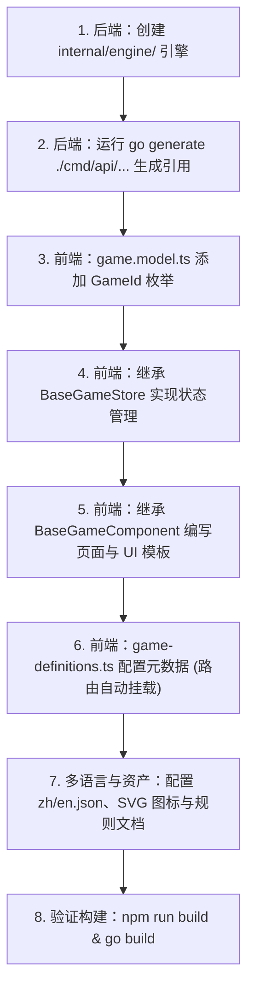

# X-Game 新增游戏开发权威指南 (Developer Guide)

> **版本**：v3.2+ (基于当前最新统一架构)  
> **适用角色**：全栈开发人员、AI 编码助手  
> **设计目标**：标准化、零侵入、高度封装。只需关注新游戏的核心业务逻辑，底层房间生命周期、断线重连、多局制胜负判定、经验代币结算与响应式视口完全由框架自动化接管。

---

## 目录
- [一、核心架构哲学与四大红线](#一核心架构哲学与四大红线)
- [二、新增游戏全流程极简路线图（7 步走）](#二新增游戏全流程极简路线图7-步走)
- [三、后端开发：实现 GameEngine (Go)](#三后端开发实现-gameengine-go)
  - [1. 目录结构与注册约定](#1-目录结构与注册约定)
  - [2. 标准对战引擎代码模版 (可直接复制)](#2-标准对战引擎代码模版-可直接复制)
  - [3. 自动注入 Blank Import](#3-自动注入-blank-import)
  - [4. (可选) 题库数据库解谜游戏：PuzzleRepo 规范](#4-可选-题库数据库解谜游戏puzzlerepo-规范)
- [四、前端开发：Store 与组件体系 (Angular 21 Signals)](#四前端开发store-与组件体系-angular-21-signals)
  - [1. 注册 GameId 枚举](#1-注册-gameid-枚举)
  - [2. 状态管理：继承 BaseGameStore](#2-状态管理继承-basegamestore)
  - [3. 页面组件：继承 BaseGameComponent](#3-页面组件继承-basegamecomponent)
  - [4. HTML 模板：使用 GameLayout 黄金骨架](#4-html-模板使用-gamelayout-黄金骨架)
- [五、路由、多语言与静态资源装配](#五路由多语言与静态资源装配)
  - [1. 注册游戏元数据：game-definitions.ts](#1-注册游戏元数据game-definitionsts)
  - [2. 国际化翻译与深度 SEO 策略文档](#2-国际化翻译与深度-seo-策略文档)
  - [3. 游戏说明文档与规则弹窗](#3-游戏说明文档与规则弹窗)
  - [4. 游戏 SVG 图标](#4-游戏-svg-图标)
- [六、避坑铁律与发布前核对清单 (Checklist)](#六避坑铁律与发布前核对清单-checklist)

---

## 一、核心架构哲学与四大红线

在动手写任何代码前，必须绝对遵守以下系统设计准则：

### 1. 🚨 单机前端算，联机后端算（计算权责分离）
- **单机模式（Single）**：100% 运行在客户端（浏览器）内存与本地状态中，纯前端计算与渲染，**绝不调用服务端或占用后端 WebSocket 资源**。
- **联机对战（PK / Speed / Score / Steal / Battle）**：强制走后端 `GameEngine` 校验与仲裁，服务端作为 Single Source of Truth，防作弊并广播对局状态。

### 2. 🚨 绝对禁止侵入公共底层（高可扩展与前后端松耦合）
- **后端**：**严禁修改** `backend/pkg/ws/manager.go` 和 `backend/pkg/ws/lobby.go`。房间调度、断线宽限期、心跳重连、幽灵房间回收均已闭环封装。新游戏只需实现独立的 `GameEngine` 接口并注册。
- **前端**：**严禁修改**公共组件内部去写针对某个游戏的 `if (gameId === 'mygame')` 特判。所有游戏公共行为全部通过 `BaseGameStore`、`BaseGameComponent` 和 `<app-game-layout>` 契约注入。

### 3. 🚨 样式零硬编码与多主题一致性
- 严禁硬编码任何物理颜色（如 `bg-slate-900`、`text-white`、`#1e293b`）。
- **必须严格使用全局 CSS 变量**（如 `var(--color-bg-card)`、`var(--color-text-main)`、`var(--color-border-card)`、`var(--color-accent-from)`），确保 Light / Dark 主题无缝切换。

### 4. 🚨 文本零硬编码与多语言规范
- 严禁在模板或 TS 逻辑中出现任何未经转译的中英文字符串。
- 所有 UI 文本必须配置在 `frontend/src/assets/i18n/zh.json` 与 `en.json`，在模板中统一使用 `{{ i18n.t('key')() }}` 绑定。

---

## 二、新增游戏全流程极简路线图（🚀 推荐：一键脚手架 CLI）

### ⚡ 极速方式：一键命令自动装配前后端基础骨架

在 `frontend` 目录下直接运行全新打造的脚手架工具：

```bash
# 格式：npm run gen:game <game_id> [中文标题] [图标Emoji]
npm run gen:game reversi "黑白棋" "⚪"
npm run gen:game tilematch "羊了个羊" "🀄"
```

该命令将在 **30 秒内全自动完成以下全部工作**：
1. **后端 Go 引擎**：自动创建 `backend/internal/engine/<id>/engine.go`（含 3 秒倒计时与多回合制闭环）；
2. **后端空白引用**：自动在 `backend/cmd/api/engines_gen.go` 注入包引用；
3. **前端本地引擎**：自动生成 `src/app/features/games/<id>/store/<id>-engine.ts`（0ms 纯客户端计算）；
4. **前端算法单测**：自动生成 `store/<id>-engine.spec.ts`（支持 `npx vitest run` 瞬时验证）；
5. **前端 Store**：自动生成继承 `BaseGameStore` 且具备防幽灵重置契约的 `<id>.store.ts`；
6. **前端组件与页面**：自动生成集成 `BaseGameComponent` 与 `<app-game-layout>` 黄金骨架的 `.component.ts/html/css`；
7. **全局配置与路由**：自动在 `game.model.ts` 追加枚举、在 `game-definitions.ts` 挂载路由（自动预渲染无需改 route 文件）；
8. **双语与 SEO 词条**：自动向 `zh.json` 与 `en.json` 注入标题与描述。

开发者只需直接聚焦在 `store/<id>-engine.ts` 中填入你的棋盘消除/移动核心算法，其余所有底层框架完全自动就绪！

---

### 手动新增极简流程（供参考）：



---

## 三、后端开发：实现 GameEngine (Go)

### 1. 目录结构与注册约定
在 `backend/internal/engine/<你的游戏ID>/` 下创建 Go 包（如 `backend/internal/engine/mygame/`）。

命名与模式约定：
- 基础游戏注册：`engine.RegisterGame("mygame")`（用于管理后台元数据与数据库自动 Seed）
- 模式引擎注册：`engine.Register("mygame_<mode>", factory)`
  - 常见模式后缀：`speed` (独立异盘竞速), `score` (单盘限时抢分), `same_score` (同种随机种子打分), `steal` (同盘抢答夺分), `battle` (相互干扰对战)

### 2. 标准对战引擎代码模版 (可直接复制)

以下是一个完整的生产级引擎模板，以内置 3 秒倒计时、标准生命周期与多局胜负制（BO3/BO5）支持为范例：

```go
// backend/internal/engine/mygame/engine.go
package mygame

import (
	"encoding/json"

	"github.com/x-game/backend/internal/engine"
)

// 玩家数据结构
type Player struct {
	ID       string `json:"id"`
	Score    int    `json:"score"`
	Progress int    `json:"progress"`
	Finished bool   `json:"finished"`
}

// 游戏对战引擎：必须组合嵌入 engine.BaseEngine
type Engine struct {
	engine.BaseEngine
	Players    map[string]*Player `json:"players"` // 🚨 必须是 map[string]*Player，禁止切片！
	Difficulty string             `json:"difficulty"`
	Winners    []string           `json:"winners"`
	Wins       map[string]int     `json:"wins"`   // 多局对战各玩家赢局数
	Target     int                `json:"target"` // 系列赛目标局数 (1/3/5)
}

func init() {
	// 1. 注册游戏基础 ID (用于数据库 gm_game_configs 自动建表与统计)
	engine.RegisterGame("mygame")
	// 2. 注册具体 PK 模式
	engine.Register("mygame_speed", func() engine.GameEngine {
		return &Engine{}
	})
}

// InitGame 初始化房间对局状态
func (e *Engine) InitGame(options interface{}) error {
	e.Mu.Lock()
	defer e.Mu.Unlock()

	e.State = engine.StateWaiting
	e.Players = make(map[string]*Player)
	e.Winners = make([]string, 0)
	e.Wins = make(map[string]int)
	e.Target = 1
	e.Difficulty = "medium"

	if opts, ok := options.(map[string]interface{}); ok {
		if diff, ok := opts["difficulty"].(string); ok && diff != "" {
			e.Difficulty = diff
		}
		if t, ok := opts["target"].(float64); ok && int(t) > 0 {
			e.Target = int(t)
		} else if t, ok := opts["target"].(int); ok && t > 0 {
			e.Target = t
		}
	}

	return nil
}

// AddPlayer 玩家连接加入房间
func (e *Engine) AddPlayer(playerID string) {
	e.Mu.Lock()
	defer e.Mu.Unlock()
	if _, exists := e.Players[playerID]; !exists {
		e.Players[playerID] = &Player{
			ID:       playerID,
			Score:    0,
			Progress: 0,
			Finished: false,
		}
	}
	if _, exists := e.Wins[playerID]; !exists {
		e.Wins[playerID] = 0
	}
}

// RemovePlayer 玩家离开房间
func (e *Engine) RemovePlayer(playerID string) {
	e.Mu.Lock()
	defer e.Mu.Unlock()
	delete(e.Players, playerID)
}

// HasPlayer 判定玩家是否存在
func (e *Engine) HasPlayer(playerID string) bool {
	e.Mu.RLock()
	defer e.Mu.RUnlock()
	_, exists := e.Players[playerID]
	return exists
}

// HandleAction 处理客户端发来的业务动作 (move, forfeit 等)
func (e *Engine) HandleAction(playerID string, action string, payload []byte) (engine.GameState, error) {
	e.Mu.Lock()
	defer e.Mu.Unlock()

	// 1. 通用房主动作处理：开始对局（触发统一 3 秒倒计时）
	if action == "start" && e.State == engine.StateWaiting {
		engine.StartWithCountdown(&e.Mu, &e.State, e.Broadcast, func() {
			// 3 秒倒计时结束、正式变为 StatePlaying 时执行的初始化
			for _, p := range e.Players {
				p.Score = 0
				p.Progress = 0
				p.Finished = false
			}
			e.Winners = make([]string, 0)
		})
		return e.State, nil
	}

	// 2. 通用再来一局动作
	if action == "restart_game" && e.State == engine.StateFinished {
		// 如果有人已达到 Target，重置大比分；否则保持 wins 累加
		seriesOver := false
		for _, w := range e.Wins {
			if w >= e.Target {
				seriesOver = true
				break
			}
		}
		if seriesOver {
			for p := range e.Wins {
				e.Wins[p] = 0
			}
		}

		for _, p := range e.Players {
			p.Score = 0
			p.Progress = 0
			p.Finished = false
		}
		e.Winners = make([]string, 0)
		e.State = engine.StateWaiting
		return e.State, nil
	}

	// 3. 游戏特定动作（如落子、消除、答题）
	if e.State == engine.StatePlaying {
		switch action {
		case "move":
			var req struct {
				Delta int `json:"delta"`
			}
			if err := json.Unmarshal(payload, &req); err == nil {
				if p, exists := e.Players[playerID]; exists {
					p.Score += req.Delta
					if p.Score >= 100 {
						p.Finished = true
						e.Winners = []string{playerID}
						e.Wins[playerID]++
						e.State = engine.StateFinished
					}
				}
			}
		case "forfeit":
			// 认输逻辑
			for id := range e.Players {
				if id != playerID {
					e.Winners = []string{id}
					e.Wins[id]++
					break
				}
			}
			e.State = engine.StateFinished
		}
	}

	return e.State, nil
}

// CheckGameOver 检查游戏是否结束及胜者
func (e *Engine) CheckGameOver() (bool, []string) {
	e.Mu.RLock()
	defer e.Mu.RUnlock()
	return e.State == engine.StateFinished, e.Winners
}

// GetState 序列化给全房间客户端广播的状态
func (e *Engine) GetState() interface{} {
	e.Mu.RLock()
	defer e.Mu.RUnlock()

	return map[string]interface{}{
		"status":     e.State,
		"players":    e.Players, // 🚨 确保此为 map 格式
		"winners":    e.Winners,
		"wins":       e.Wins,
		"target":     e.Target,
		"difficulty": e.Difficulty,
	}
}
```

### 3. 自动注入 Blank Import
编写完 Go 引擎后，**千万不要手动修改 `main.go`**！只需在 `backend` 目录下执行自动代码生成命令：

```bash
cd backend && go generate ./cmd/api/...
```

`gen_engines.go` 脚本会自动扫描 `internal/engine/` 下的所有子目录，并把新引擎的空白引用自动注入到 `backend/cmd/api/engines_gen.go` 中。

---

## 四、前端开发：Store 与组件体系 (Angular 21 Signals)

前端核心采用 **Angular 21 无区化 (Zoneless) Signals 架构**。每个游戏位于 `frontend/src/app/features/games/<game_id>/` 独立模块中。

### 1. 注册 GameId 枚举
打开 `frontend/src/app/core/models/game.model.ts`，在 `GameId` 对象中追加游戏唯一标识：

```typescript
export const GameId = {
  // ...已有游戏
  MyGame: 'mygame',
} as const;
```

### 2. 状态管理：继承 BaseGameStore
在 `frontend/src/app/features/games/mygame/store/mygame.store.ts` 中创建状态管理类。

> **核心原则**：所有通用房间连接、断线重连、倒计时音频、单人终局存档自动清理、PK 结算经验自动提交均已在 `BaseGameStore` 实现，不要重复手写！

```typescript
import { Injectable, computed, signal, effect, untracked } from '@angular/core';
import { BaseGameStore } from '../../../../core/store/base-game.store';
import { GameMode, GameStatus, GameStatusType } from '../../../../core/models/game.model';
import { C2SAction } from '../../../../core/models/websocket.model';

@Injectable()
export class MyGameStore extends BaseGameStore {
  readonly gameId = 'mygame';

  // 1. 本地状态信号 (单人与基础状态)
  localScore = signal<number>(0);
  singleStatus = signal<GameStatusType>(GameStatus.Waiting);

  // 2. 必须实现：单人模式状态映射 (基类要求)
  readonly singlePlayerStatus = computed(() => this.singleStatus());
  override readonly singlePlayerWinners = computed(() => 
    this.singleStatus() === GameStatus.Finished && this.localScore() > 0 ? [this.playerId()] : []
  );

  constructor() {
    super();

    // 3. 监听多人 WebSocket 广播状态更新本地表现
    effect(() => {
      const raw = this.rawState() as any;
      if (this.currentRoomMode() === GameMode.Single || !raw) return;

      // 根据后端广播的数据更新本地信号
      if (raw.players && raw.players[this.playerId()]) {
        // 同步自己的云端得分等数据
      }
    });
  }

  // 4. 用户交互动作
  makeMove(scoreGain: number) {
    if (this.currentRoomMode() === GameMode.Single) {
      // 单机模式：纯本地内存更新，0 延迟
      this.localScore.update(s => s + scoreGain);
      if (this.localScore() >= 100) {
        this.singleStatus.set(GameStatus.Finished);
      }
    } else {
      // 联机模式：向服务端发送 WS 动作
      this.ws.sendAction(C2SAction.Move, { delta: scoreGain });
    }
  }

  // 5. 终局胜负契约 (Universal Victory Contract):
  // BaseGameStore 默认已实现标准 isVictory 与 isDefeat 信号。
  // 单机解谜游戏通关默认即为胜利；若是死局类游戏（如 2048/消除），死局标志会自动判定为失败；
  // 如有极其特殊的业务胜负逻辑，可直接重写 override readonly isVictory = computed<boolean>(() => ...)
}
```

### 3. 页面组件：继承 BaseGameComponent
在 `frontend/src/app/features/games/mygame/mygame.component.ts` 中：

```typescript
import { Component, inject, OnInit, OnDestroy, computed } from '@angular/core';
import { CommonModule } from '@angular/common';
import { BaseGameComponent } from '../../../core/utils/base-game.component';
import { MyGameStore } from './store/mygame.store';
import { GameLayoutComponent } from '../../../shared/components/game-layout/game-layout.component';
import { GamePkHudComponent } from '../../../shared/components/game-pk-hud/game-pk-hud.component';
import { PkPlayerStats } from '../../../shared/components/game-pk-hud/game-pk-hud.model';

@Component({
  selector: 'app-mygame',
  standalone: true,
  imports: [
    CommonModule,
    GameLayoutComponent,
    GamePkHudComponent,
  ],
  providers: [MyGameStore],
  templateUrl: './mygame.component.html'
})
export class MyGameComponent extends BaseGameComponent implements OnInit, OnDestroy {
  override store = inject(MyGameStore);
  // ✨ BaseGameComponent 自动提供 authStore, router, toast, audio, haptic, i18n,
  // GameMode, GameStatus, GameDifficulty, Math, math, t, showRules, showOverlay, playerId 等！无需重复定义！

  // 对手 PK 进度 HUD 映射
  readonly opponentPkStats = computed<PkPlayerStats[]>(() => {
    if (this.store.currentRoomMode() === this.GameMode.Single) return [];
    const myId = this.playerId;
    const raw = this.store.rawState() as any;
    const players = raw?.players || {};
    return Object.keys(players)
      .filter(id => id !== myId)
      .map(id => ({
        id,
        nickname: id,
        score: players[id].score || 0,
        progress: players[id].progress || 0,
        finished: players[id].finished || false,
      }));
  });

  override ngOnInit(): void {
    super.ngOnInit(); // 必须调用：自动连接大厅 WS 并监听同游戏房间快速迎战
    if (this.store.currentRoomMode() === this.GameMode.Single) {
      this.store.startSingleGame();
    }
  }

  override ngOnDestroy(): void {
    super.ngOnDestroy(); // 必须调用：清理房间与未竟监听
    this.store.leaveRoom();
  }
}
```

### 4. HTML 模板：使用 GameLayout 黄金骨架 (v3.2.47+ 自动编排器)
在 `frontend/src/app/features/games/mygame/mygame.component.html` 中：

> **✨ v3.2.47 极致精简**：只需传入 `[store]="store"` 与 `[overlayStats]="..."`，**联机等待室 (`GameWaitingRoom`)、3 秒倒计时 (`GameStartingOverlay`) 与终局结算 (`GameResultOverlay`) 均由 `<app-game-layout>` 自动内聚管理**！无需在子组件重复书写 60+ 行等待室与弹窗模板！

```html
<app-game-layout
  [gameId]="'mygame'"
  [store]="store"
  [title]="i18nBase.t('lobby.mygame')()"
  icon="🎮"
  iconGradientClass="from-indigo-500 to-cyan-500"
  titleGradientClass="from-indigo-400 to-cyan-400"
  shadowClass="shadow-cyan-500/20"
  [showRules]="showRules()"
  [showMobileSidebar]="isMobileSidebarOpen()"
  [overlayStats]="[{ label: '得分', value: store.localScore() }]"
  (rulesClosed)="showRules.set(false)"
  (rulesOpen)="showRules.set(true)"
  (titleClick)="handleTitleClick()"
  (back)="goBack()"
  (playAgain)="store.startSingleGame()"
  (joinRoom)="handleJoinRoom($event)"
  (createRoom)="handleCreateRoom($event)"
  (mobileSidebarClosed)="isMobileSidebarOpen.set(false)"
>
  <!-- 核心操作舞台：开发者只需专注于自身独有的棋盘/画布！ -->
  <div class="flex-1 w-full h-full flex flex-col items-center justify-between p-2 sm:p-4 min-h-0">
    
    <!-- PK 对战实时比分 HUD (仅在多人对战且进行中时呈现) -->
    @if (store.currentRoomMode() !== GameMode.Single) {
      <app-game-pk-hud
        [myStats]="{ id: playerId, nickname: playerId, score: store.localScore(), progress: 0, finished: false }"
        [opponents]="opponentPkStats()"
        [roundFormat]="store.room()?.roundFormat || 'BO3'"
        [seriesScore]="{ me: store.pkWins()[playerId] || 0, opponent: store.pkWins()[opponentPkStats()[0]?.id || ''] || 0 }"
      />
    }

    <!-- 核心棋盘 / 画布区域 -->
    <div class="my-auto flex items-center justify-center">
      <button (click)="store.makeMove(10)" 
              class="px-6 py-3 rounded-2xl bg-gradient-to-r from-emerald-500 to-teal-500 text-white font-bold active:scale-95 transition-all shadow-lg cursor-pointer">
        点击得分 (+10) - 当前: {{ store.localScore() }}
      </button>
    </div>
  </div>
</app-game-layout>
```

> **提示**：如果游戏具有特殊的终局展示需求（例如自定义游戏结束画面），可传入 `[autoManageOverlays]="false"`，此时 `<app-game-layout>` 会退回至自由插槽模式，允许开发者在 `<ng-content>` 中自定义控制覆盖层。

---

## 五、路由、多语言与静态资源装配

### 1. 注册游戏元数据：game-definitions.ts
打开 `frontend/src/app/core/config/game-definitions.ts`，在 `GAME_DEFINITIONS` 数组中添加配置项。

> 💡 **无需手动修改 `app.routes.ts`**！前端路由与文档路由由 `GAME_DEFINITIONS` 自动全量生成并预渲染。

```typescript
{
  id: GameId.MyGame,
  route: '/games/mygame',
  titleKey: 'lobby.mygame',
  iconEmoji: '🎮',
  loadComponent: () => import('../../features/games/mygame/mygame.component').then(m => m.MyGameComponent),
  modes: [
    { id: GameMode.Single, labelKey: 'game.single_label', descKey: 'game.single_desc', icon: '👤', desc: 'Single Player' },
    { id: GameMode.Speed,  labelKey: 'game.same_pk_speed_label', descKey: 'game.same_pk_speed_desc', icon: '🏎️', desc: 'Speed PK' },
  ],
  difficulties: [
    { id: GameDifficulty.Easy,   labelKey: 'game.diff_easy',   descKey: '...', desc: 'Easy' },
    { id: GameDifficulty.Medium, labelKey: 'game.diff_medium', descKey: '...', desc: 'Medium' },
    { id: GameDifficulty.Hard,   labelKey: 'game.diff_hard',   descKey: '...', desc: 'Hard' },
  ],
  recommendations: ['minesweeper', 'sudoku'],
  multiRound: true, // 开启 1/3/5 局 PK 胜负制选择器
  coverImage: 'og-mygame.png',
}
```

### 2. 国际化翻译与深度 SEO 策略文档
在 `frontend/src/assets/i18n/zh.json` 与 `en.json` 中配置对应词条：

```json
// zh.json
{
  "lobby.mygame": "我的新游戏",
  "seo.mygame.title": "我的新游戏在线玩 - 双人实时对战 | 益智游戏PK网",
  "seo.mygame.desc": "免费在线体验我的新游戏，支持单人练习与多人在线实时竞速对决。",
  "seo.mygame.keywords": "益智游戏, 我的新游戏, 双人PK, 在线游戏",
  "game.mygame.seo_desc": "<h2>关于我的新游戏</h2><p>详细的玩法介绍与高阶博弈技巧策略长文（由 GameLayout 底部自动吸附渲染，极大促进全站 SEO）。</p>"
}
```

### 3. 游戏说明文档与规则弹窗
在 `frontend/public/assets/games-docs.json` 末尾为该游戏添加说明对象，在玩家点击游戏头部「📖 规则」按钮时自动展示：

```json
{
  "id": "mygame",
  "name": "{\"en\": \"My Game\", \"zh\": \"我的新游戏\"}",
  "overview": "{\"en\": \"Short overview\", \"zh\": \"简明扼要的一句话游戏介绍。\"}",
  "rules": "{\"en\": \"# Rules\\n\\n1. Step one...\", \"zh\": \"# 游戏规则\\n\\n1. 第一步...\\n2. 第二步...\"}",
  "isActive": true
}
```

### 4. 游戏 SVG 图标
将游戏的专属 SVG 图标放置在：
`frontend/public/assets/games/icons/mygame.svg`
（全站大厅、房间列表与头部将自动读取该图标）。

---

## 六、避坑铁律与发布前核对清单 (Checklist)

| 检查项 | 为什么如此严格？ | 正确操作 |
|---|---|---|
| **后端 Players 字段格式** | 若使用 `[]string` 切片，前端 `Object.keys()` 会把数组下标 (`0`, `1`) 当作玩家 ID，导致等候室头像错位与皇冠丢失。 | 必须使用 `map[string]*Player` 映射。 |
| **Blank Import 生成** | 若手动改 `main.go` 容易造成冲突或被覆盖。 | 运行 `cd backend && go generate ./cmd/api/...`。 |
| **等候室 `[target]` 传递** | 若未向等候室传递 `[target]="store.currentRoomTarget()"`，多人房间的胜局目标（BO3/BO5）无法正常显示。 | 模板必须绑定 `[target]`。 |
| **继承父类钩子** | `BaseGameComponent` 内置了 WebSocket 大厅连接与深度链接监听。若子类 override 了 `ngOnInit`/`ngOnDestroy` 却漏调 `super`，将导致断连失效。 | 必须在第一行调用 `super.ngOnInit()` 与 `super.ngOnDestroy()`。 |
| **单机终局存档安全** | 严禁将失败或 Finished 状态的坏局写入本地存储，否则下次进入将出现死局弹窗。 | 状态管理交由 `BaseGameStore` 自动清理。 |
| **移动端触控防抖** | 棋盘拖拽等手势若无容器约束容易拉动整页。 | 外层外壳交由 `GameLayoutComponent`，舞台在等待时启用 `touch-pan-y`，游玩时由 `BaseGameComponent` 锁定。 |
| **文档与构建验证** | 每次增加新游戏后必须确保系统文档同步与构建 100% 成功。 | 运行 `cd frontend && npm run build` 以及 `cd backend && go build ./cmd/api/...`。 |
